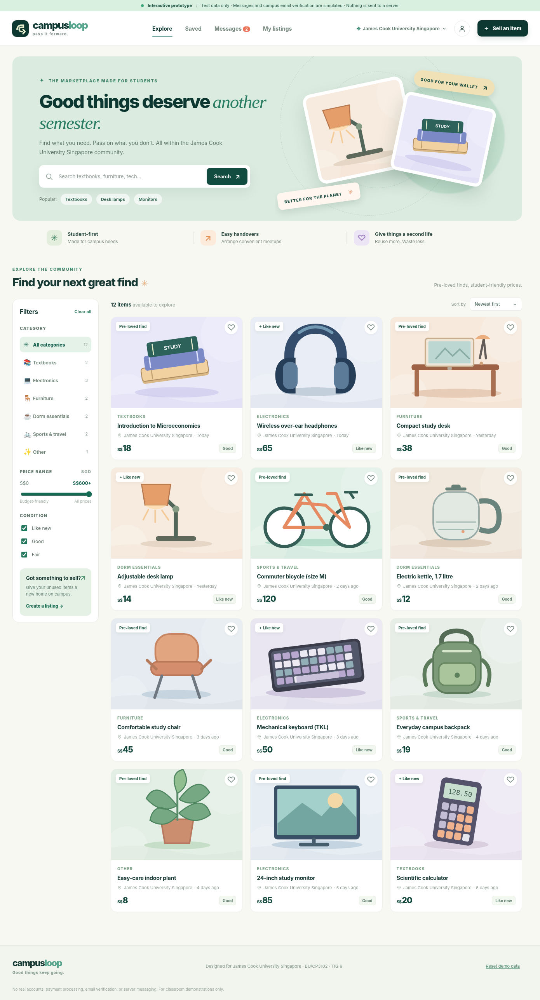
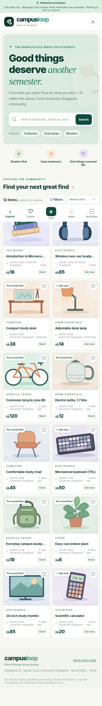

# Student-to-Student Marketplace

**CampusLoop — JCU Singapore front-end demo**

**A student-to-student second-hand marketplace prototype**  
BU/CP3102 Multidisciplinary Project · TIG 6 · James Cook University Singapore

> **Academic demo only.** CampusLoop is a front-end prototype created for coursework. Listings, student accounts and conversations are simulated. This is not an official James Cook University service, and no real identity verification or transactions take place.



## About the project

The **Student-to-Student Marketplace** project, demonstrated through the **CampusLoop** website, explores a simple idea: students should have an easier way to pass on useful items instead of leaving them unused or throwing them away. The prototype focuses on second-hand goods commonly used by university students, such as textbooks, electronics, furniture, and everyday essentials.

The project is designed around the **James Cook University Singapore** community, with an emphasis on affordability, convenience and reuse. It demonstrates the proposed user journey and provides a working interface for usability testing; it does **not** demonstrate a live campus marketplace.

## Features

| Feature | What the demo does |
| --- | --- |
| Explore listings | Displays 12 sample products with item details, conditions, prices in SGD and a campus location. |
| Search and filter | Search by keywords; filter by category, maximum price and condition; sort results. |
| Product details | View an item's description, seller name and listing information. |
| Saved items | Add or remove products from a personal shortlist. |
| Demo account | Continue with a fictional email in the `@jcu.edu` format (for example, `student@jcu.edu`). Only the email format is checked. |
| Post a listing | Create a local listing with a title, category, condition, price, description and optional photo. |
| Manage listings | Edit, delete, mark as sold or relist items created in the browser. |
| Demo messages | Open example conversations and type messages that remain in the current browser. |
| Responsive layout | Adapt the interface for desktop and mobile screens. |
| Reset demo | Restore the original example listings and clear local demo activity. |

The bundled product images are **SVG illustrations**, not photographs of actual items for sale.

## Technology

- **HTML5** — page structure and accessible form elements
- **CSS3** — layout, visual styling and responsive design
- **Vanilla JavaScript** — interface interactions, filtering and form handling
- **Browser `localStorage`** — temporary persistence of demo accounts, listings, favorites and messages

No framework, package installation, database or API key is needed.

## Getting started

1. Download or clone this repository.
2. Open the project folder.
3. Open **`index.html`** in a modern browser such as Chrome, Edge or Safari.
4. Explore the example products or select **Sell an item** to try the demo flow.

For an optional local development server, run the following command from the project folder:

```bash
python3 -m http.server 8000
```

Then visit `http://localhost:8000`.

### Suggested demo walkthrough

1. Search for **textbooks** and apply a category or price filter.
2. Open a product and save it using the heart icon.
3. Go to **Saved** to view the shortlist.
4. Click **Sell an item** and enter the fictional demo email `student@jcu.edu`.
5. Create a sample listing, edit its price and mark it as sold under **My listings**.
6. Open a sample product's messaging flow and type a simulated message.
7. Use **Reset demo data** in the footer when you want a fresh starting point.

**Note:** The `@jcu.edu` restriction is a **demo configuration**, not a verified statement about the university's actual email system. Do not use a real password or provide sensitive personal data.

## Project structure

```text
Student-to-Student-Marketplace/
├── index.html                # Main page and app views
├── styles.css                # Styling and responsive layouts
├── app.js                    # Listing data and front-end interactions
├── assets/                   # SVG logo and product illustrations
├── evidence/
│   ├── Desktop_Overview.png  # Desktop screenshot
│   └── Mobile_Overview.png   # Mobile screenshot
├── TEST_CASES.md             # Developer QA and usability test plan
├── USER_TEST_TEMPLATE.csv    # Blank user-testing record sheet
└── README.md
```

## Deploying with GitHub Pages

This project is a static website, so it can be published using GitHub Pages.

1. Create a GitHub repository and upload the **contents** of this project folder, with `index.html` at the repository root.
2. Open **Settings → Pages** in the repository.
3. Under **Build and deployment**, select **Deploy from a branch**, choose `main` and `/(root)`, then save.
4. When deployment finishes, open the site URL shown on the Pages settings screen.

The resulting address commonly follows this format:

```text
https://YOUR-USERNAME.github.io/YOUR-REPOSITORY/
```

You can add the actual GitHub Pages link near the top of this README after publishing the site.

## Testing and assessment evidence

The repository includes `TEST_CASES.md`, which documents the developer's functional test checklist and a proposed user-evaluation method. It also includes `USER_TEST_TEMPLATE.csv` for recording **real** participant observations. The two screenshots in `evidence/` may be used as prototype evidence in the BU/CP3102 final portfolio.

The existing QA document reports successful developer checks, but those checks should **not** be presented as evidence of real user satisfaction, production readiness or a security audit. Usability findings should be based on actual participants and recorded results.

### Mobile preview



## Current limitations

- **No real authentication:** the form checks only whether the email follows the configured `@jcu.edu` pattern. It does not send verification emails or confirm student enrolment.
- **No shared database:** created listings, favorites and messages are stored locally in the visitor's browser and are not synchronized between users or devices.
- **No real-time chat:** messages are simulated and are not delivered to sellers.
- **No payment, order or delivery system:** prices and transactions are illustrative only.
- **No live product inventory:** the included products and sellers are fictional sample data.
- **Browser storage limits:** uploaded photos are resized for local storage, and saved demo data may be lost when browser data is cleared or storage is blocked.

## Possible future improvements

- Add a backend API and persistent database for real listings.
- Implement secure university account verification using an approved authentication method.
- Enable user-to-user messaging and listing moderation.
- Conduct structured usability testing and document design improvements.
- Improve accessibility and cross-browser testing based on actual findings.

---

**Student-to-Student Marketplace · CampusLoop demo · BU/CP3102 · TIG 6**  
*Front-end prototype for academic demonstration and evaluation.*
